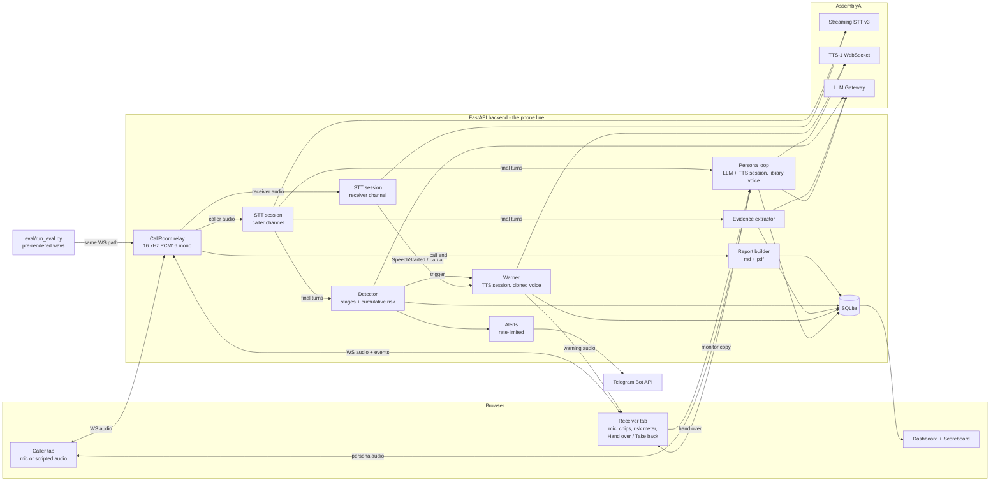

# Kavach — Plan

Status: **Phase A (PLAN), waiting for approval.** No code written yet.
API facts this plan relies on are in [docs/API_NOTES.md](docs/API_NOTES.md). Decisions are in [DECISIONS.md](DECISIONS.md).

## 1. Architecture



Key points:
- The backend owns every AssemblyAI connection. **The API key never reaches the browser**, so browser temp tokens aren't needed.
- One audio format end to end: **16 kHz, PCM s16le, mono, ~50 ms frames**. STT's default input and a supported TTS output rate, so there's no resampling on the server. The browser resamples the mic with an AudioWorklet.
- Speaker identity comes from the channel (caller WS vs receiver WS). No diarization.
- The eval harness is a headless WebSocket client. It connects as Caller and Receiver to the same `/ws/call/{id}/{role}` endpoints and streams pre-rendered wavs in real time, so the detector, warner and timing code paths are exactly the live ones.

## 2. Modules

| Module | Responsibility |
|---|---|
| `app/config.py` | Pydantic settings from `.env`: keys, voice IDs, models, threshold, language, decoy data, rate limits |
| `app/main.py` | FastAPI app, static pages, REST (`/health`, `/api/calls`, `/api/report/{id}`, `/api/eval/...`), WS endpoints `/ws/call/{id}/{caller\|receiver}` and `/ws/events/{id}` |
| `app/call_room.py` | Holds a call's two parties. Relays audio between them, taps each channel to its STT session, mutes the receiver→caller path during takeover, injects TTS audio, broadcasts UI events, owns per-call timing log |
| `app/stt.py` | Async client for one STT v3 session: connect, send PCM, parse `Begin/SpeechStarted/Turn/Termination/Error`, emit callbacks, always `Terminate` |
| `app/tts.py` | Async client for one TTS-1 WS session: Begin check, `Generate/Flush/Cancel/KeepAlive/Terminate`, drops tail frames between Cancel and Cancelled, timestamps first `Audio`. Shared by warner and persona |
| `app/detector.py` | Per caller final turn: LLM call over the last ~6 turns → `{stages, evidence_quotes, risk, rationale}` (Pydantic-validated, one retry). Cumulative risk with hysteresis + combo rule → trigger |
| `app/warner.py` | Opens the cloned-voice TTS session at call start. On trigger, picks a template by main stage, streams it to the Receiver, logs time-to-first-audio. On receiver `SpeechStarted` / partial → `Cancel` + tell the browser to flush its playback queue |
| `app/persona.py` | Takeover loop: caller final turn → LLM (streamed) → TTS (library voice) → Caller tab (+ monitor copy to Receiver). Decoy-only output guard. Caller `SpeechStarted` cancels persona speech. Take back = instant `Cancel` + unmute |
| `app/evidence.py` | LLM entity extraction per caller turn (`{type, value, quote, timestamp}`), regex validation/normalization for UPI, IFSC, phone, URL, account numbers |
| `app/alerts.py` | Telegram `sendMessage` (+ `sendDocument` for the PDF). At most 1 per stage change, max 3 per call. IST timestamps |
| `app/report.py` | 1930 complaint draft, Markdown + PDF (ReportLab), "DRAFT — review before filing" banner, next-steps footer |
| `app/llm.py` | Single shared `httpx.AsyncClient` to the LLM Gateway. JSON-schema structured output + `json-repair`, timeouts, latency logging |
| `app/store.py` | SQLite schema + small typed helpers |
| `app/timing.py` | Monotonic timestamps per call, written as events (one place to compute every latency) |
| `web/` | `caller.html`, `receiver.html`, `dashboard.html`, `scoreboard.html`, shared `audio.js` (AudioWorklet capture + gapless PCM player with instant flush) |
| `eval/generate_scripts.py` | LLM writes 90 scripts (45 scam / 30 legit / 15 hard-negative) to `eval/scripts/*.json`, with seed + fixed split |
| `eval/render_audio.py` | TTS-1 renders every turn. **One TTS WS session per voice**, reused across scripts, to stay under 5 sessions/min. Writes wav + timing JSON |
| `eval/run_eval.py` | Streams each test call through the live backend, records triggers and timings |
| `eval/replay_detector.py` | Offline: re-runs only the detector over cached STT turns from a train-split run. Used for threshold/prompt tuning without re-streaming audio |
| `eval/metrics.py` | Recall, FPR (legit and hard-neg separately), seconds decisive→warning (median, p90), TTFA median, % caught before S5/S6, confusion matrix |

## 3. Data model (SQLite)

```
calls(id PK, mode[live|eval], script_id NULL, caller_number, started_at, ended_at,
      label NULL, scam_type NULL, max_risk, warned_at NULL, takeover_at NULL,
      money_shared NULL, otp_shared NULL, report_md_path NULL, report_pdf_path NULL)
turns(id PK, call_id FK, channel[caller|receiver|persona|warning], idx, text,
      audio_start_ms, audio_end_ms, final_at_mono, is_decoy BOOL)
detections(id PK, call_id FK, turn_id FK, stages JSON, evidence_quotes JSON,
           risk_llm INT, risk_cum REAL, rationale, triggered BOOL, llm_ms INT, model)
evidence(id PK, call_id FK, turn_id FK, type, value, normalized, quote, ts_ms, valid BOOL)
events(id PK, call_id FK, ts_mono, ts_wall, type, payload JSON)
   -- types: stt_begin, speech_started, turn_final, detect, trigger, warn_tts_sent,
   --        warn_first_audio_server, warn_first_audio_browser, barge_in, cancel_sent,
   --        cancelled, takeover, takeback, persona_reply, alert_sent, call_end, error
eval_runs(id PK, split, config JSON, started_at, finished_at, metrics JSON)
eval_results(run_id FK, script_id, label, category, predicted BOOL, trigger_turn_idx,
             decisive_turn_idx, s5s6_turn_idx, secs_decisive_to_warning, ttfa_ms,
             caught_before_s5s6 BOOL)
```

Eval script JSON:
```json
{"id": "scam_digital_arrest_007", "label": "scam", "category": "scam|legit|hard_negative",
 "scam_type": "digital_arrest", "split": "train|test", "caller_number": "+91 98xxxxxx12",
 "decisive_turn_index": 3, "first_s5_s6_turn_index": 7,
 "turns": [{"speaker": "caller", "text": "..."}, {"speaker": "receiver", "text": "..."}]}
```

## 4. Core algorithms

**Cumulative risk** (per caller final turn, LLM risk `r` in 0–100):
- rise fast: if `r > R`: `R ← R + 0.7·(r − R)`
- decay slowly: else `R ← max(r, R − 4)`
- **trigger** when `R ≥ threshold` (default 70, configurable, tuned on train only) **or** (stage set ∩ {S5,S6,S7} ≠ ∅ **and** stage set ∩ {S1,S2,S3} ≠ ∅), where stage set accumulates over the call.
- One warning per call, plus at most one re-warning if S6 or S7 first appears after the first warning.

**Latency budget** for warning ≤ 3 s after the end of the triggering caller turn:
| Step | Expected |
|---|---|
| STT final after last word (balanced mode) | 0.2–1.3 s |
| LLM detector (gpt-6-luna, no reasoning, keep-alive) | ~0.9 s p50, 1.2 s p95 |
| TTS first audio on a pre-opened session | ~0.1–0.3 s |
| WS to browser + playback start | < 0.1 s |
| **Total** | **~1.3–2.9 s** |
"End of caller turn" = `audio_end_ms` of the last word, converted to the call's monotonic clock. Every step is logged as an event.

## 5. Risks and fallbacks

| Risk | Fallback |
|---|---|
| Free-plan limits: 5 new STT sessions/min, 5 TTS WS sessions/min, 50 TTS HTTP req/min | Render eval audio with 1 TTS session per voice (≈12 sessions total). Eval runner paces call starts (each call = 2 STT + 1 TTS session). Detector tuning replays cached transcripts offline. Upgrade to paid if available (ask) |
| STT is throttled to 1.25× real time, so eval runs take wall-clock time | Test split only (~36 calls) for live runs; run concurrently within the session/min budget. Estimate ≈ 25–40 min per full test run on free tier |
| Warning latency > 3 s | (1) Speculative detector call on long caller pauses / partials. (2) `min_latency` STT mode on the caller channel. (3) Faster model (`mercury-3`). (4) Last resort: pre-synthesize template audio at call start (still TTS-1, but loses the streaming demo), documented if used |
| Echo: the warning plays on the Receiver's speakers, leaks into the Receiver mic, and falsely triggers barge-in | Use headphones for the demo. `echoCancellation: true`. Ignore receiver speech for 400 ms after warning start, and drop receiver partials that fuzzy-match the warning text |
| Two mics on one laptop pick up each other | Demo: Caller tab plays a scripted scam (pre-rendered TTS) instead of a live mic. Live mic caller is optional on a second device |
| LLM returns bad JSON / times out | JSON-schema structured output + `json-repair`, Pydantic validation, 1 retry, Gateway fallback model, 2.5 s timeout. A detector failure never blocks the call |
| Persona leaks real data or says something unsafe | Prompt with decoy data only, output guard rejects any ≥ 6-digit number / email / UPI not in the decoy list, every decoy logged with `is_decoy=1` |
| Cloned voice not ready (`voice_not_paired`) / expired / biometric terms not accepted | Startup check opens a session with the voice and reports the exact error. Fallback to a library voice with a visible "not cloned" badge (never silent) |
| Synthetic eval inflates numbers | Generator model family ≠ detector family; held-out test split; hard negatives; caveat in README |
| TTS-1 has no Indian-English voices in the starter list | Look for Indian-accent voices in the dashboard catalog; otherwise mix US/UK/AU/Scottish voices and say so |
| WeasyPrint needs system libs on macOS | ReportLab (pure-Python wheel) |
| Python 3.14 is too new for some wheels | `uv` pins Python 3.12 for the project |

## 6. Milestones and verification gates

Each gate's evidence (command output, log excerpt, file path, metric) goes into `PROGRESS.md` before the commit. After each milestone: re-run all earlier gates and run an independent review subagent (Phase C).

| M | Date (IST) | Deliverable | Verification gate (exact) |
|---|---|---|---|
| M0 | Sat Oct 31 | `uv` project, config, `.env.example`, `.gitignore`, `/health`, key check | `uv run pytest -q` passes. `uv run python scripts/check_keys.py` prints: STT session `Begin` model name, one TTS voice resolved via a 1-sentence synthesis (`x-tts-voice-id`), LLM Gateway reply, cloned voice `Begin` + `voice_expires_at`, Telegram `getMe` ok |
| M1 | Sat Oct 31 | Call relay + per-channel streaming STT | `uv run pytest tests/test_call_room.py` (fake STT) passes. Live: `uv run python scripts/smoke_call.py` streams a 2-voice wav through both WS roles and prints per-channel finals + latency (`final_at − audio_end`). Manual two-tab check with screenshot path. STT model A/B (`universal-3-6-pro` vs `universal-streaming-english`) latency table |
| M2 | Sun Nov 1 | Detector + risk + UI chips | `uv run pytest tests/test_detector.py` — 10 fixed transcripts (5 scam must trigger, 5 legit must not), live LLM, results logged. Unit tests for the hysteresis math (no network). Live spoken scam script through the simulator lights the expected stage chips (event log + screenshot) |
| M3 | Mon Nov 2 | Family-voice warning + barge-in | `scripts/smoke_warning.py`: trigger → warning in cloned voice (`Begin.resolved_voice` = clone ID); event log shows `trigger→first_audio_browser` and `turn_end→first_audio_browser` ≤ 3 s over 5 runs. Barge-in run: receiver speech starts at t, `Cancel` sent and browser playback stopped; log `speech_started→playback_stopped` ms |
| M4 | Tue Nov 3 | Eval: scripts, rendering, runner, scoreboard | `eval/generate_scripts.py` → 90 valid JSONs (schema test). `render_audio.py` → wav + timing for every turn (count check). `run_eval.py --split test` completes. `/scoreboard` shows recall, FPR (legit + hard-neg), decisive→warning median/p90, TTFA median, % before S5/S6, confusion matrix (screenshot) |
| M5 | Wed Nov 4 | Takeover persona + evidence | `scripts/smoke_takeover.py`: scripted scammer (TTS caller) vs persona for ≥ 2 min. Transcript saved. Evidence table has ≥ 3 entities matching the script's planted UPI/account/phone. Take back: `Cancel` + unmute within 300 ms (logged). Decoy guard unit test passes |
| M6 | Thu Nov 5 | Telegram alerts + 1930 report | A real Telegram message arrives (API `ok:true` + your confirmation/screenshot). Rate-limit unit test (≤ 1/stage change, ≤ 3/call). PDF generated from a test call, opened, every field filled (field-coverage test + screenshot). **Feature freeze.** |
| M7 | Fri Nov 6 | Hardening, README, diagrams, demo script | Fresh `git clone` into a temp dir → README's ≤ 5 setup commands → `/health` ok → `smoke_call.py` passes |
| M8 | Sat Nov 7 | Buffer, final checks, submit by 18:00 IST | `VERIFICATION_REPORT.md` all green: full regression of M0–M6 gates + end-to-end scam (digital arrest) and legit run with evidence |

If a milestone slips more than half a day, I'll tell you right away with options. I won't silently cut scope.

## 7. What I need from you

1. **AssemblyAI API key** in `.env` (I'll create `.env.example`). Also tell me: **free or paid plan?** Free means 5 new STT sessions/min and 5 TTS sessions/min, which makes eval runs slow but doable.
2. **Accept the biometric data terms** at https://www.assemblyai.com/dashboard/settings/data-controls (required to use a cloned voice).
3. **Your cloned voice ID** (`KAVACH_WARNING_VOICE_ID`): clone in the **US** data zone, 10–30 s, close mic (AirPods are fine), quiet room, calm tone, ideally saying something like the warning. It expires after 60 days.
4. **Telegram:** create a bot with @BotFather and give me the **bot token**, then send your bot any message from the phone that should get alerts. I'll read the chat ID with `getUpdates`.
5. **How the warning addresses your parent** (default "Papa"), and your own name as the family member, for the templates.
6. **Permission to `git init`** this folder and commit locally. Tell me if there's a GitHub repo to push to for submission. I won't push without asking.
