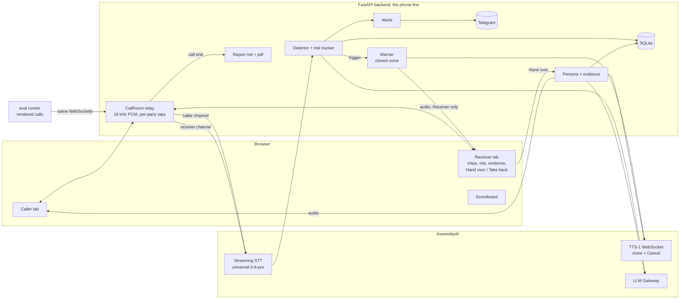

# Kavach

**Real-time scam-call protection that speaks.** Built for AssemblyAI's "Voice hackathon week: Hack into speech".

> Others beep. Kavach speaks, in your son's voice, takes over the call, alerts the family, and writes the police
> complaint. And we can prove how well it works.

## The problem

A parent gets a call from a "police officer" or "CBI" or "customs": a parcel with drugs, an arrest warrant, "stay on
the line and tell no one", then a demand to pay into a "safe account". These digital-arrest and KYC scams cost Indian
families crores every month. Today's tools (Google Scam Detection, Truecaller, Airtel Fraud Alert) show a banner or
beep. A frightened 70-year-old mid-call often does not look at a banner.

## What Kavach does

| | Feature | How |
|---|---|---|
| F1 | **Listens and spots scam stages live** | Streaming speech-to-text on the caller's channel; an LLM tags seven scam stages per turn; a cumulative risk score rises fast and decays slowly |
| F2 | **Warns in a family member's voice** | AssemblyAI TTS-1 with a cloned voice, streamed; stops the instant the parent speaks |
| F3 | **Takes over the call** | One button hands the call to a slow, polite, confused persona (decoy facts only) that keeps the scammer talking and pulls out UPI IDs, accounts, IFSC, names, numbers and links; **Take back** is instant |
| F4 | **Alerts the family** | Telegram message with risk, stages, a snippet and the time (IST): warning, takeover, call end; at most 3 per call |
| F5 | **Writes the 1930 complaint draft** | Markdown and PDF with every captured detail, timestamped quotes, next steps. A draft: nothing is ever submitted |
| F6 | **Proves it** | 90 synthetic calls, tuned on 54, scored on 36 held-out calls through the same pipeline; scoreboard page |

## Architecture



The backend is the only thing that talks to AssemblyAI, so the API key never reaches a browser. Each party's audio
is tapped on its own channel, so who is speaking comes from the channel, not from diarization. The eval runner plays
rendered calls into the same two WebSocket endpoints a browser uses, so the metrics measure the real pipeline.

## How AssemblyAI is used

- **Streaming speech-to-text** (`universal-3-6-pro`, English): one session per party. Its entity-aware turn detection
  keeps phone numbers and IDs in one turn, and `SpeechStarted` is a fast barge-in signal.
- **TTS-1 streaming over WebSocket**: one long-lived session per voice; `Generate` + `Flush` per reply; **`Cancel` for
  barge-in** (the audio that arrives between our `Cancel` and the server's `Cancelled` is dropped, never played).
- **Voice cloning**: the warning voice is a consented clone of the family member's own voice, made in the dashboard.
  The persona uses a library voice so the two are never confused.
- **LLM Gateway** (OpenAI-compatible): scam-stage detection, persona replies, evidence extraction, and the eval
  script writer (a different model family from the detector).

## Run it

```bash
git clone <this repo> kavach && cd kavach
uv sync
cp .env.example .env        # add ASSEMBLYAI_API_KEY, KAVACH_WARNING_VOICE_ID, TELEGRAM_BOT_TOKEN, TELEGRAM_CHAT_ID
uv run python scripts/check_keys.py       # every line should say OK
uv run uvicorn app.main:app --port 8000   # open http://localhost:8000
```

Open the Caller and Receiver tabs from the start page with the same call id (use headphones on the Receiver). The
demo, step by step, is in [docs/DEMO_SCRIPT.md](docs/DEMO_SCRIPT.md). To replay the eval:
`uv run python -m eval.run_eval --split test` (about 40 minutes, real time).

## Safety and ethics

- **Consented cloning only.** The warning voice is the user's own, cloned from their own recording.
- **Decoy-only persona.** The persona may only say the fake details in `app/config.py` (a fake name, city, bank and
  phone). Every reply passes an output guard that blocks digits, addresses and invented number runs, and every persona
  turn is flagged as a decoy in the log.
- **Draft-only report.** The complaint is a draft the user reviews and files themselves at cybercrime.gov.in or via
  1930. Nothing is ever auto-submitted anywhere.
- **No real calls.** It is a simulator. No outbound calls, no real numbers.
- **Secrets stay server-side** in `.env` (git-ignored); the Telegram token is kept out of logs.
- Eval calls never send real family alerts.

## Limitations (please read)

- **A simulator, not telephony.** Real phone-call capture needs a dialer or carrier integration; this version stands in
  for it with two browser tabs.
- **English only.** The language is a config value. Hindi is planned as soon as AssemblyAI ships Hindi TTS (streaming
  speech-to-text already lists `hi`).
- **Synthetic eval audio.** TTS audio is cleaner than a real phone line, so real-world numbers may be lower.
- **Small test set.** 36 calls: a single call moves a rate by about 3 points.
- **No auth.** Anyone who can reach the server and knows a call id can join it. Fine for a demo; not for production.
- **Shared TTS session.** A barge-in on one call would cancel the warning of another concurrent call.
- **Free-tier limits** shaped the design: the LLM account allows 30 requests per minute, and 5 new streaming sessions
  per minute.

RESULTS_PLACEHOLDER
