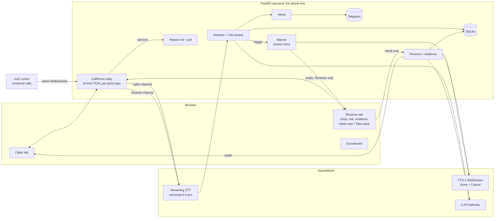

# Kavach

**Real-time scam-call protection that speaks.** Built for AssemblyAI's "Voice hackathon week: Hack into speech".

> Others beep. Kavach speaks, in your son's voice, takes over the call, alerts the family, and writes the police
> complaint. And we can prove how well it works.

## The problem

A parent gets a call from a "police officer" or "CBI" or "customs": a parcel with drugs, an arrest warrant, "stay on
the line and tell no one", then a demand to pay into a "safe account". These digital-arrest and KYC scams cost Indian
families crores every month. Today's tools (Google Scam Detection, Truecaller, Airtel Fraud Alert) show a banner or
beep. A frightened 70-year-old mid-call often does not look at a banner.

## What Kavach does

| | Feature | How |
|---|---|---|
| F1 | **Listens and spots scam stages live** | Streaming speech-to-text on the caller's channel; an LLM tags seven scam stages per turn; a cumulative risk score rises fast and decays slowly |
| F2 | **Warns in a family member's voice** | AssemblyAI TTS-1 with a cloned voice, streamed; stops the instant the parent speaks |
| F3 | **Takes over the call** | One button hands the call to a slow, polite, confused persona (decoy facts only) that keeps the scammer talking and pulls out UPI IDs, accounts, IFSC, names, numbers and links; **Take back** is instant |
| F4 | **Alerts the family** | Telegram message with risk, stages, a snippet and the time (IST): warning, takeover, call end; at most 3 per call |
| F5 | **Writes the 1930 complaint draft** | Markdown and PDF with every captured detail, timestamped quotes, next steps. A draft: nothing is ever submitted |
| F6 | **Proves it** | 90 synthetic calls, tuned on 54, scored on 36 held-out calls through the same pipeline; scoreboard page |

## Architecture



The backend is the only thing that talks to AssemblyAI, so the API key never reaches a browser. Each party's audio
is tapped on its own channel, so who is speaking comes from the channel, not from diarization. The eval runner plays
rendered calls into the same two WebSocket endpoints a browser uses, so the metrics measure the real pipeline.

## How AssemblyAI is used

- **Streaming speech-to-text** (`universal-3-6-pro`, English): one session per party. Its entity-aware turn detection
  keeps phone numbers and IDs in one turn, and `SpeechStarted` is a fast barge-in signal.
- **TTS-1 streaming over WebSocket**: one long-lived session per voice; `Generate` + `Flush` per reply; **`Cancel` for
  barge-in** (the audio that arrives between our `Cancel` and the server's `Cancelled` is dropped, never played).
- **Voice cloning**: the warning voice is a consented clone of the family member's own voice, made in the dashboard.
  The persona uses a library voice so the two are never confused.
- **LLM Gateway** (OpenAI-compatible): scam-stage detection, persona replies, evidence extraction, and the eval
  script writer (a different model family from the detector).

## Run it

```bash
git clone <this repo> kavach && cd kavach
uv sync
cp .env.example .env        # add ASSEMBLYAI_API_KEY, KAVACH_WARNING_VOICE_ID, TELEGRAM_BOT_TOKEN, TELEGRAM_CHAT_ID
uv run python scripts/check_keys.py       # every line should say OK
uv run uvicorn app.main:app --port 8000   # open http://localhost:8000
```

Open the Caller and Receiver tabs from the start page with the same call id (use headphones on the Receiver). The
demo, step by step, is in [docs/DEMO_SCRIPT.md](docs/DEMO_SCRIPT.md). A **real phone call** can be tried too: put the call on speaker next to the laptop and open the Listener page; see
[docs/REAL_PHONE_DEMO.md](docs/REAL_PHONE_DEMO.md) (honest limits included).

To replay the eval, first render the test calls (about 10 minutes, ~$0.60 of TTS, audio is not stored in git), then run
them through the live server (about 40 minutes, real time):
`uv run python -m eval.render_audio --split test` then `uv run python -m eval.run_eval --split test`.

## Safety and ethics

- **Consented cloning only.** The warning voice is the user's own, cloned from their own recording.
- **Decoy-only persona.** The persona may only say the fake details in `app/config.py` (a fake name, city, bank and
  phone). Every reply passes an output guard that blocks digits, addresses and invented number runs, and every persona
  turn is flagged as a decoy in the log.
- **Draft-only report.** The complaint is a draft the user reviews and files themselves at cybercrime.gov.in or via
  1930. Nothing is ever auto-submitted anywhere.
- **No real calls.** It is a simulator. No outbound calls, no real numbers.
- **Secrets stay server-side** in `.env` (git-ignored); the Telegram token is kept out of logs.
- Eval calls never send real family alerts.

## Limitations (please read)

- **A simulator, not telephony.** Real phone-call capture needs a dialer or carrier integration; this version stands in
  for it with two browser tabs.
- **English only.** The language is a config value. Hindi is planned as soon as AssemblyAI ships Hindi TTS (streaming
  speech-to-text already lists `hi`).
- **Synthetic eval audio.** TTS audio is cleaner than a real phone line, so real-world numbers may be lower.
- **Small test set.** 36 calls: a single call moves a rate by about 3 points.
- **No auth.** Anyone who can reach the server and knows a call id can join it. Fine for a demo; not for production.
- **Shared TTS session.** A barge-in on one call would cancel the warning of another concurrent call.
- **Free-tier limits** shaped the design: the LLM account allows 30 requests per minute, and 5 new streaming sessions
  per minute.

## Results

### Held-out test split: 36 calls the system was never tuned on

How it was built: 90 call scripts written by `gemma-4-31b` (a different model family from the detector, which is
`qwen3.5-4b-32k-fast`): 45 scam in six types, 30 legitimate, 15 "hard negatives" (genuine calls that mention OTPs or
police safely). Split 54 train / 36 test, stratified by type. Every turn is rendered with TTS-1 in different voices and
accents and streamed in real time through the live backend as two separate microphones: real streaming
speech-to-text, the real detector, the real warning in the cloned voice. **The prompt and threshold (60) were tuned
on the 54 train calls only and frozen before the test split was ever run.**

| Test split (36 calls) | Run 1 (`f549bd5`) | Run 2 (`bc5bf5a`) | **Run 3 (`69ce935`, final code)** |
|---|---|---|---|
| Scam recall | 18/18 | 18/18 | **18/18** |
| False alarms on normal calls | 0/12 | 1/12 | **0/12** |
| False alarms on hard negatives | 0/6 | 0/6 | **0/6** |
| Caller's last word → warning audio, median / p90 | 1529 / 1668 ms | 1552 / 1625 ms | **1461 / 1571 ms** (n=11 *) |
| Warning voice, time to first audio (median) | 401 ms | 398 ms | **401 ms** |
| Caught before the OTP/money request | 15/18 (83%) | 12/18 (67%) | **13/18 (72%)** |
| Decisive turn → warning, median / p90 | -11.9 s / +2.1 s | -11.5 s / +14.9 s | **-8.8 s / +6.9 s** |
| Errors / transcription incidents / detector errors | 0 / 0 / 0 | 0 / 0 / 1 | **0 / 0 / 0** |

\* In 7 of the 18 scam calls the scripted receiver replied to the scammer so quickly that the first warning was cut off
before any audio played and was repeated afterwards (as designed), so those calls have no "first attempt" timing; the
warning was heard in all 18.

The same frozen prompt and threshold (60) were used in all three runs; the code changed between them (an independent
review, then a second one, fixed real problems) and **run 3 is the run on the final code**: every file under `app/`
is identical to commit `69ce935`; nothing in `app/` has changed since.

**How to read these numbers honestly**

- **It is a small test.** 18 scams and 18 non-scams. Zero misses is consistent with a true recall anywhere from about
  82% to 100%; one false alarm in 18 is consistent with a true false-alarm rate from about 0.1% to 27% (zero in 18 would still allow up to about 18%). One call moves a
  rate by about 3 to 6 points.
- **A small language model is not deterministic at the margin.** The same frozen system on the same audio gave 0/12,
  1/12 and 0/12 false alarms and 15/18, 12/18 and 13/18 "caught before the ask" across the three runs. The one false alarm (run 2) was a **genuine** bank
  fraud-team call that says "I am blocking your debit card immediately" after a large flagged transaction; it peaked at
  a risk score of 54.6 in run 1 (threshold 60), 78.2 in run 2 and 7 in run 3. It is the clearest weakness: a real bank call that
  sounds firm. Margins are thin both ways: in run 3 the highest-scoring non-scam calls peaked at 50.8 and 45.5, and the weakest scams
  crossed the line at 54.6 (by the stage rule, not the score) and 61.6; in run 1 two scams only just crossed the threshold
  (60.5, 61.6); in run 2 a hard negative peaked at 57.8, 2.2 below it.
- **"Decisive turn" is an LLM-written label**, usually later than the point where a careful person would first worry,
  so the median is negative (the system warned before the label). The number that matters for a protected person is
  the **1.5 s** from the caller's last word to the warning audio.
- **The OTP/money ask is often the same turn as the decisive turn** (22 of 45 scripts), so "caught before the ask"
  means flagging earlier than the dataset itself says is certain.
- **Synthetic audio is cleaner than a real phone line.** Real-world numbers may be lower.
- A scam whose warning the person talks over is repeated when they stop speaking (up to three times). In run 1 one
  warning was cancelled by the person's reply before it was heard and never replayed; that was fixed.

### Other measured behaviour (loopback, TTS-rendered audio)

| Check | Result |
|---|---|
| Family-voice warning after the caller's last word | 1.3 to 1.9 s over 8 live runs (target 3 s); it starts 0.4 s after the trigger |
| Barge-in: person speaks, playback stops | stop command reaches the receiver in about 1 ms, including audio already delivered |
| Takeover: details captured from a scripted scammer in about 3 minutes | 6 of 6 planted details (UPI ID, account, IFSC, callback number, name, link) |
| Persona reply after the scammer stops | about 2.2 to 3.2 s (includes a 0.7 s wait to let the caller finish) |
| Take back while the persona is mid-sentence | cancelled in 0 ms, zero stray frames, caller hears the user again |
| Family alerts | 3 real Telegram messages (warning, takeover, call end with the PDF) in one call |

What these do **not** show: the persona coaxing details out of a *reluctant* scammer (in the scripted gate the scammer
reveals them; an adaptive LLM scammer got 1 to 3 of 6 depending on the run), and real microphone capture, which needs a
real browser and headphones.

Everything is reproducible: `docs/evidence/` holds the raw eval results for both runs, the train-split sweeps, and the
takeover and regression runs; `PROGRESS.md` is the full log, including the failed attempts.

